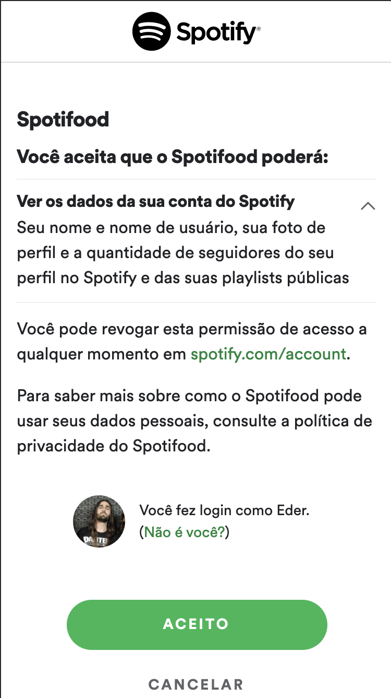
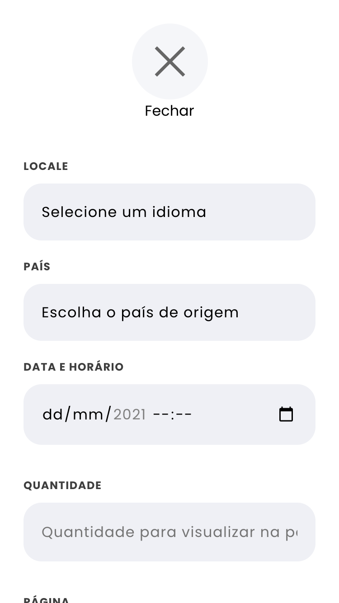
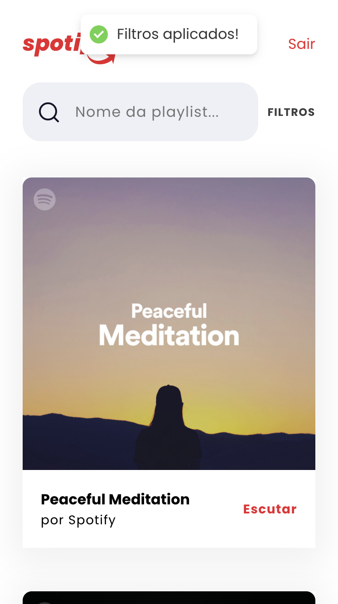

<h1 align="center"></h1>

<p align="center">Playlists to enjoy with your food order. Designed in Figma, built as a small design system plus the app that consumes it.</p>

<p align="center">
  <a href="https://spotifood-ten.vercel.app">Live app</a> ·
  <a href="https://spotifood-components.vercel.app/?path=/docs/components-button--primary">Storybook</a> ·
  <a href="https://www.figma.com/design/ZYNcMs2B7uDiFCmw9mBvZQ">Figma</a>
</p>

## What it is

I designed the pages, components and design tokens in [Figma](https://www.figma.com/design/ZYNcMs2B7uDiFCmw9mBvZQ) first, then built them as three packages:

- [`design-tokens`](./packages/tokens): DTCG token sets (core, light, dark) built by Style Dictionary into a typed theme and CSS variables; the same sets back the Figma variables
- [`ui-components`](./packages/ui): the component library, documented in Storybook
- [`app`](./apps/web): the playlist browser (search, filter by genre and occasion, applied-filter chips, empty and error states)

## Structure

- `apps/web`: the playlist browser app (Vite + React), organized by feature
- `packages/ui`: the component library and its Storybook
- `packages/tokens`: design tokens consumed by the app and the components
- `tooling/*`: shared ESLint and Stylelint configs

## Design decisions

- **Tokens and components before screens.** The hardest call was the build order. I designed the screens in Figma, but in code I didn't start with them: first I pulled the tokens (type scale, font sizes, spacing, colors) out of the Figma file, then documented every component in Storybook, and only then assembled the pages. The first screen took longer to appear, but every screen after it was built from the same documented pieces, so the Figma file, Storybook and the app never drifted apart.

- **Decoupled the UI from Spotify.** The app originally logged in with Spotify and listed its featured playlists. In 2024–2025 Spotify removed both the Implicit Grant flow and `featured-playlists` for development-mode apps, and only allowlisted accounts could sign in, so a visitor would see nothing. The UI now reads a versioned JSON through a real `fetch`. Loading, error and empty states behave exactly as they would against an API, and swapping in a real endpoint is a one-line change.
- **Filters that mean something to the user.** The old filters mirrored Spotify's query params (`locale`, `timestamp`, `offset`). They are now *genre* and *occasion* (Breakfast, Lunch, Dinner, Late night, Party), with options derived from the data so the UI never offers a filter that returns nothing.
- **Generated covers.** Cover art is a two-color gradient rendered as an inline SVG data URL: no copyrighted artwork and zero image requests.
- **Native elements for interactions.** Applied-filter chips and "Clear" are real `<button>`s (they were clickable `<div>`s), so they work with the keyboard and screen readers.

## 2026 refresh: before / after

| | Before (2021) | After |
| --- | --- | --- |
| Build tool | Create React App 4 | Vite 5 |
| Package manager | Yarn 1 + Lerna | Bun workspaces |
| Tests | Jest | Vitest + Testing Library |
| React | 17 | 18 |
| Runtime deps (app) | axios, swr, react-router, web-vitals, service worker | none beyond React, styled-components, react-hot-toast |
| Initial JS | 264 kB (84 kB gzip) | 209 kB (69 kB gzip) |

JS sizes are the initial chunks, gzip -9: the "before" figure was measured from the 2021 production deploy.

<details>
<summary>2021 screens (Spotify login flow)</summary>



</details>

## Getting started

Requires [Bun](https://bun.sh) 1.3+.

```bash
bun install        # also builds design-tokens and ui-components
bun run start      # app at http://127.0.0.1:3000
bun run storybook  # component docs
```

| Command | Description |
| --- | --- |
| `bun run start` | Run the app |
| `bun run build-app` | Build the app to `apps/web/dist` |
| `bun run test:ci` | Run all tests with coverage |
| `bun run lint` / `bun run lint:css` | ESLint / Stylelint |
| `bun run storybook` | Run Storybook |
| `bun run build-storybook` | Build Storybook to `packages/ui/public` |
| `bun run watch:tokens` / `bun run watch:components` | Rebuild packages on change |

## Code standards

[JavaScript Standard Style](https://standardjs.com/), [ESLint](https://eslint.org/), [Stylelint](https://stylelint.io/) and [Conventional Commits](https://conventionalcommits.org), with shared configs in [`tooling`](./tooling).
