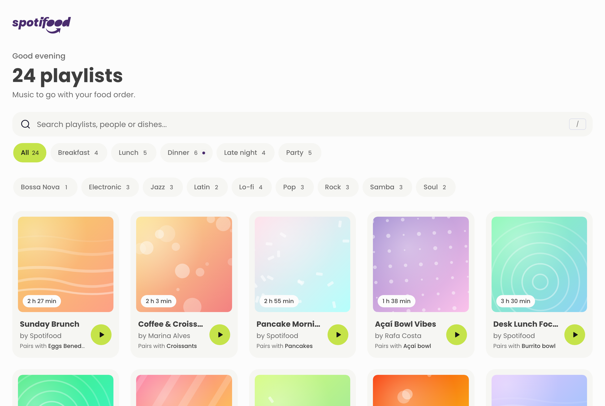
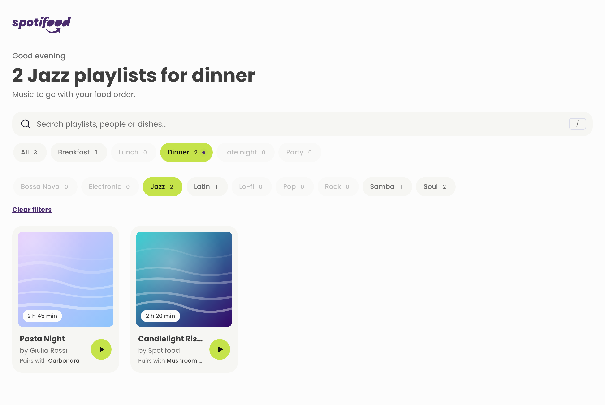
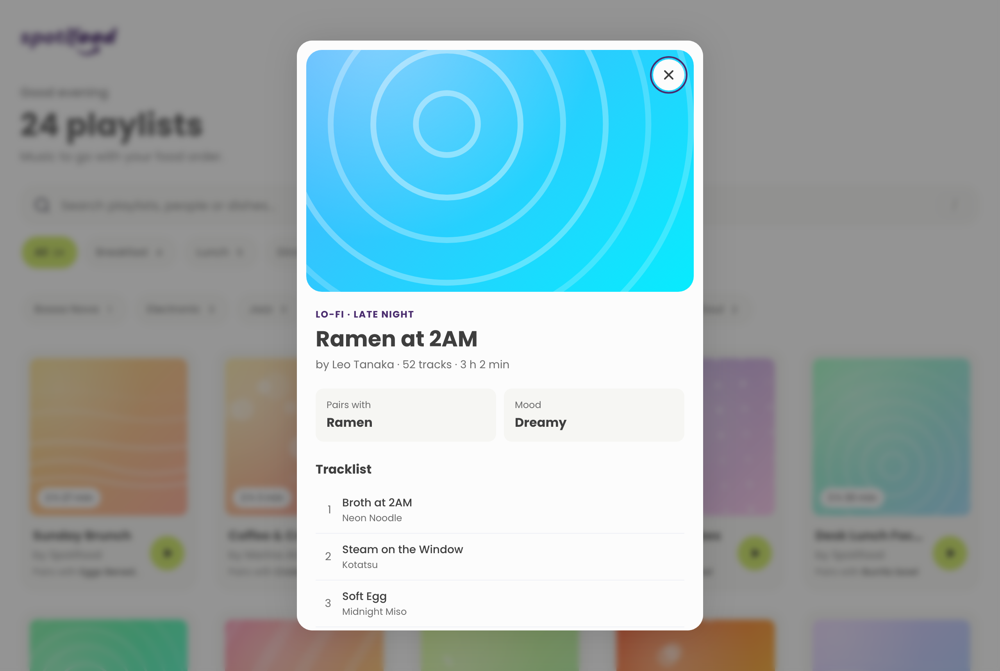
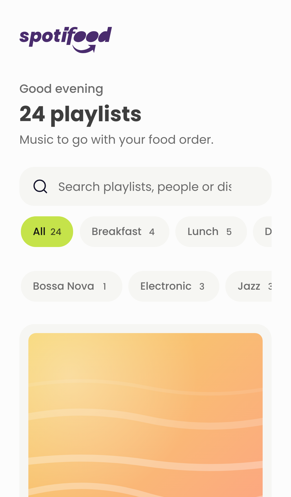
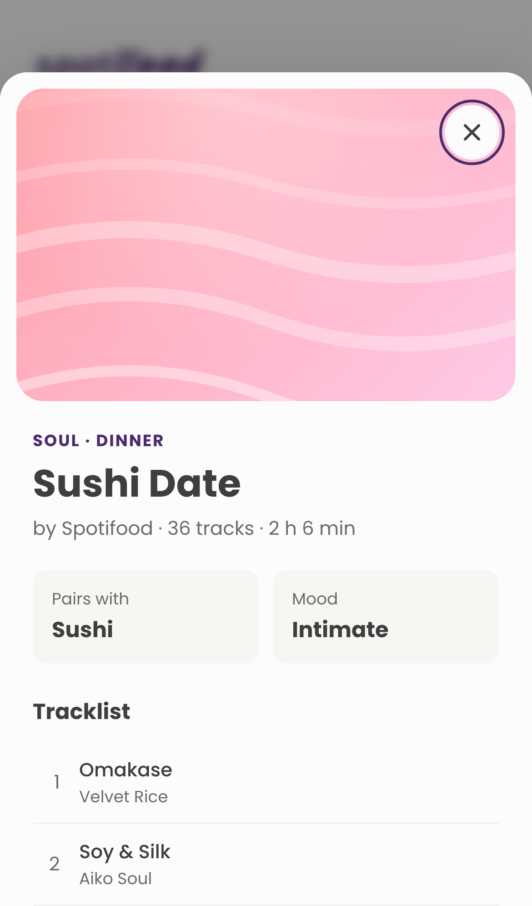
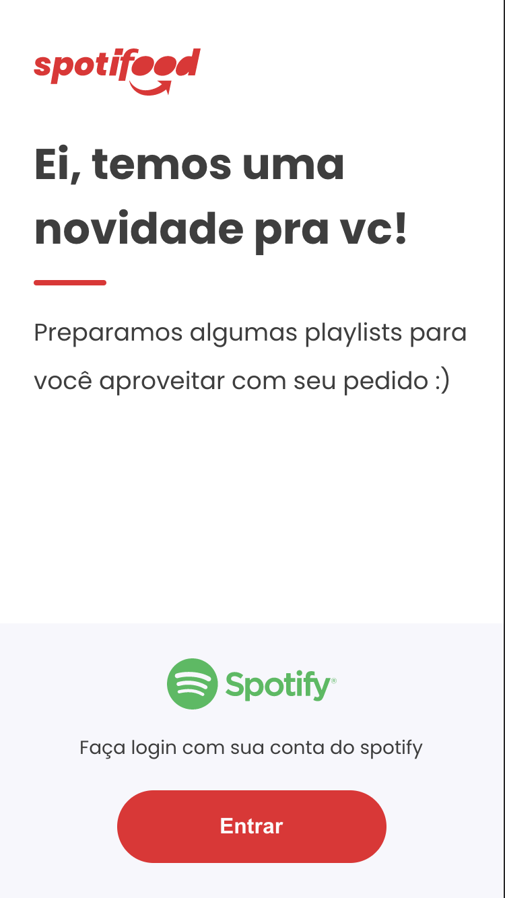
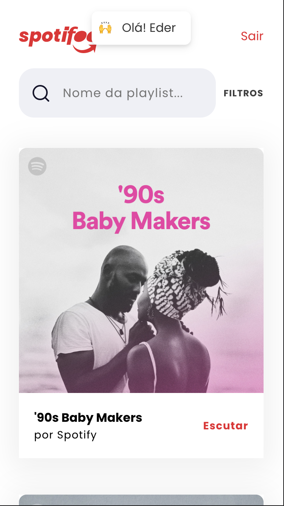

<h1 align="center"></h1>

<p align="center">Playlists to go with your food order. Designed in Figma, built as a small design system plus the app that consumes it.</p>

<p align="center">
  <a href="https://spotifood-ten.vercel.app">Live app</a> ·
  <a href="https://spotifood-components.vercel.app">Storybook</a> ·
  <a href="https://www.figma.com/design/ZYNcMs2B7uDiFCmw9mBvZQ">Figma</a>
</p>

<p align="center"></p>

## What it is

A playlist browser for food orders: pick the meal, narrow by genre or search for a dish, open a playlist to see its tracks. The page knows what time it is and suggests the matching meal, without hiding anything.

It is three packages in one Bun monorepo:

- [`packages/tokens`](./packages/tokens): DTCG design tokens, built by Style Dictionary into a typed theme and CSS variables. The same file backs the Figma variables ([Figma ↔ code workflow](./packages/tokens/README.md#figma--code-workflow)).
- [`packages/ui`](./packages/ui): the component library, documented in [Storybook](https://spotifood-components.vercel.app).
- [`apps/web`](./apps/web): the app (Vite + React), organized by feature.

## Screens

| Home | Filtered | Detail |
| --- | --- | --- |
|  |  |  |

| Phone | Phone detail (bottom sheet) |
| --- | --- |
|  |  |

## Design decisions

**Tokens and components before screens.** The hardest call was the build order. I designed the screens in Figma, but in code I didn't start with them: first I pulled the tokens (type scale, font sizes, spacing, colors) out of the Figma file, then documented every component in Storybook, and only then assembled the pages. The first screen took longer to appear, but every screen after it was built from the same documented pieces, so the Figma file, Storybook and the app never drifted apart.

**One job per color.** The old red brand also read as "error", so the main button looked like an alert. The palette now gives each color a single role: basil (`#C5E34A`) for actions, aubergine (`#4A2C6E`) for the brand, red only for errors. Contrast decided the details: text on basil is near-black (12.7:1; white would be 1.45:1), the logo and spinner use aubergine (11.2:1), and the hover and soft shades are derived from `primary` in the token file, so changing one color in Figma updates all three. Roles and ratios are in the [token README](./packages/tokens/README.md#color-roles).

**Filters on the surface, with no dead ends.** Filters used to sit behind a "FILTERS" link → side modal → selects → an "applied filters" row → toasts. Now meal and genre are one tap each, as chips. Every chip shows how many results it would give with the other filters applied, and a chip that would return nothing is disabled, so the page never offers an empty result. The active chip stays clickable at zero, so it can always be unset. The selection lives in the URL (`?occasion=Dinner&genre=Jazz`), so a filtered view can be shared and survives reload and Back.

**Context that suggests, never decides.** The hero reads the selection ("2 Jazz playlists for dinner") and greets by the visitor's time of day. The meal that matches the hour gets a small dot, but the list always starts complete: preselecting it would hide most of the content from someone who just arrived.

**Native motion, 0 kB.** Every animation uses the platform:

- Filtering runs inside a View Transition, so cards glide to their new places.
- Opening a playlist is a *container transform*: the card's surface grows into the dialog while its cover flies into place, and Back reverses it.
- The chip indicator slides like a segmented control: labels never move, and their weight never changes.

The hard part was layering, found by recording frames at 10× slower speed. Named elements paint above the page, so the cards, the count and the active chip floated above the dialog's backdrop. A new cover was snapshotted before it had decoded, and so came out blank. Detail transitions now drop those names, wait for `img.decode()`, and set an explicit stacking order. Everything is off under `prefers-reduced-motion`.

**Generated covers.** Each genre draws its own SVG motif over a two-color gradient (waves for jazz, rings for lo-fi, a dot grid for electronic, stripes for rock), and a PRNG seeded by the playlist id places it. Every cover is unique, identical on every render, and costs zero requests and no copyrighted art.

**Decoupled from Spotify.** The app first logged in with Spotify and listed its featured playlists. In 2024–2025 Spotify removed both the Implicit Grant flow and `featured-playlists` for development-mode apps, so a visitor would have seen nothing. The UI now reads a versioned JSON through a real `fetch`. Loading, error and empty states behave as they would against an API, so pointing it at a real endpoint is a one-line change.

**Figma ↔ code through a pull request.** Tokens Studio pushes token changes from Figma to a branch. CI regenerates the TypeScript and CSS, refreshes the snapshots, runs the tests and opens a PR with a Vercel preview, so a color change is reviewed like code. [Workflow](./packages/tokens/README.md#figma--code-workflow).

## Quality

| | |
| --- | --- |
| Unit and component tests | 94 (Vitest, Jest + Testing Library), including the facet counts, URL state, time-of-day rules and generated covers |
| Browser tests | Playwright on desktop and Pixel 7: filtering, dish search, empty state, the detail dialog with Back and shared links, the `/` shortcut. Screenshots are compared against baselines rendered on CI's Linux runner, with motion reduced and the clock fixed |
| Lighthouse (CI, median of 3) | Performance 95 · Accessibility 100 · Best practices 100 · SEO 100 |
| Layout shift | CLS ≈ 0.05 → 0.01 on CI: the skeleton matches the card's height, empty chip rows reserve their space, and line heights no longer depend on which font has loaded |
| Initial JS | 222 kB (71 kB gzip), with no animation or UI library |

## Before / after

| | Before (2021) | After |
| --- | --- | --- |
| Build tool | Create React App 4 | Vite 5 |
| Package manager | Yarn 1 + Lerna | Bun workspaces |
| Tests | Jest, snapshots | Vitest + Jest + Playwright visual tests, Lighthouse in CI |
| React | 17 | 18 |
| Runtime deps (app) | axios, swr, react-router, web-vitals, service worker | React and styled-components only |
| Data | Spotify API behind a login | Static JSON behind a real `fetch` |
| Initial JS | 264 kB (84 kB gzip) | 222 kB (71 kB gzip) |

JS sizes are the initial chunks, gzip -9. The "before" figure was measured from the 2021 production deploy.

<details>
<summary>Before (2021): Spotify login flow</summary>



</details>

## Getting started

Requires [Bun](https://bun.sh) 1.3+.

```bash
bun install        # also builds design-tokens and ui-components
bun run start      # app at http://127.0.0.1:3000
bun run storybook  # component docs
```

| Command | Description |
| --- | --- |
| `bun run start` | Run the app |
| `bun run build-app` | Build the app to `apps/web/dist` |
| `bun run test:ci` | Unit and component tests with coverage |
| `cd apps/web && bun run test:e2e` | Playwright browser tests (after `bun run build`) |
| `bun run lint` / `bun run lint:css` | ESLint / Stylelint |
| `bun run storybook` / `bun run build-storybook` | Storybook (dev / build to `packages/ui/public`) |
| `bun run build:tokens` | Regenerate tokens from `packages/tokens/tokens.json` |

## Code standards

[JavaScript Standard Style](https://standardjs.com/), [ESLint](https://eslint.org/), [Stylelint](https://stylelint.io/) and [Conventional Commits](https://conventionalcommits.org), with shared configs in [`tooling`](./tooling).
